# MLB Matchup Projections

[](https://github.com/LKohn4/mlb-matchup-projections/actions/workflows/ci.yml)


**Fill in a scoresheet for any MLB game (lineups, bench, starter, opener, relievers, closer, park, day or night) and get a projection for every player in the matchup, learned from the 2026 season.**

Each plate appearance is modeled from 52 variables:

- platoon splits
- each pitcher's pitch mix against how each hitter handles those pitches
- batter-vs-pitcher history
- times through the order
- home/away, day/night, and the park
- hot and cold streaks

A Monte Carlo simulator then plays the game 10,000 times to work out how often each hitter comes up, which pitcher he faces, and what he's likely to do.

> Built by **Leo Kohn** ([@LKohn4](https://github.com/LKohn4)). Companion to [mlb-hit-probability](https://github.com/LKohn4/mlb-hit-probability).

---

## Dashboard

<!-- The images below are created by `mlb-matchup train` in results/figures/. -->

### Example game: the season's two best teams

The training run automatically projects a showcase game between 2026's two best teams by run differential.

| | |
| :---: | :---: |
| 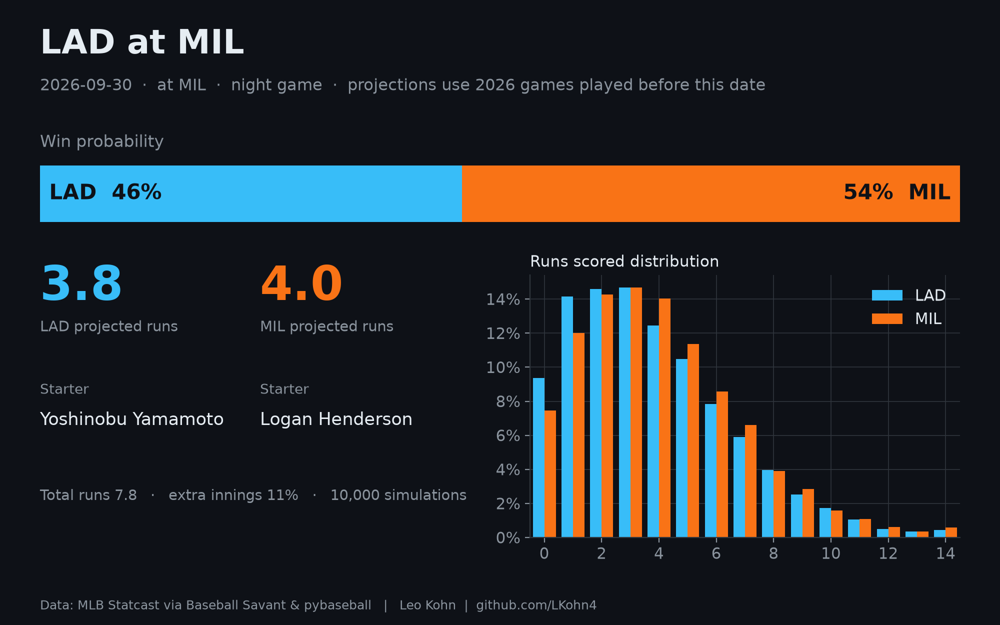 | 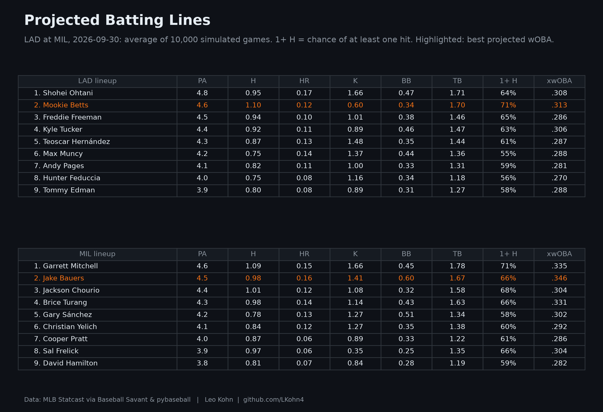 |
| **Win probability, projected runs, and the run distribution** | **Every hitter's projected line** |

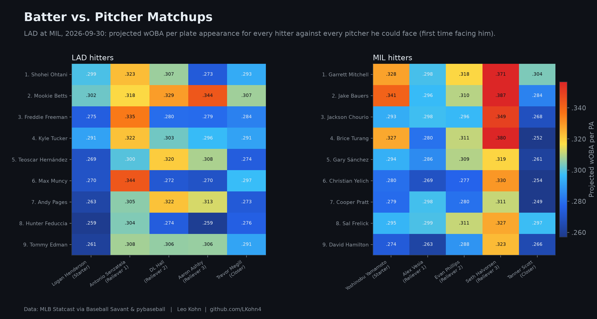
**Every hitter against every pitcher he could face.** Projected wOBA per plate appearance.

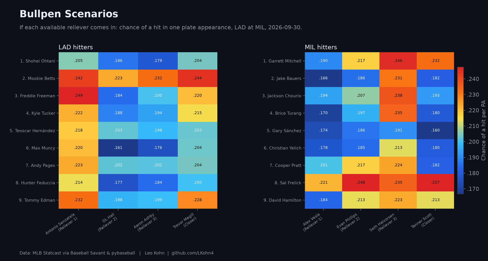
**"What if this reliever comes in?"** Each hitter's chance of a hit against each available reliever.

### How good is the model?

| | |
| :---: | :---: |
| 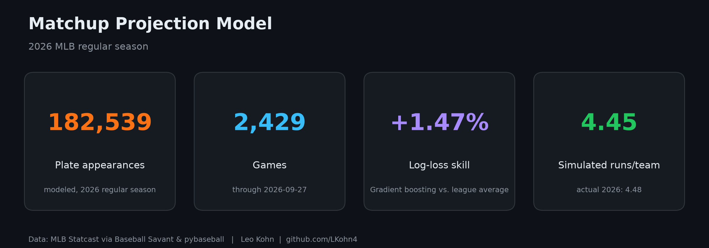 | 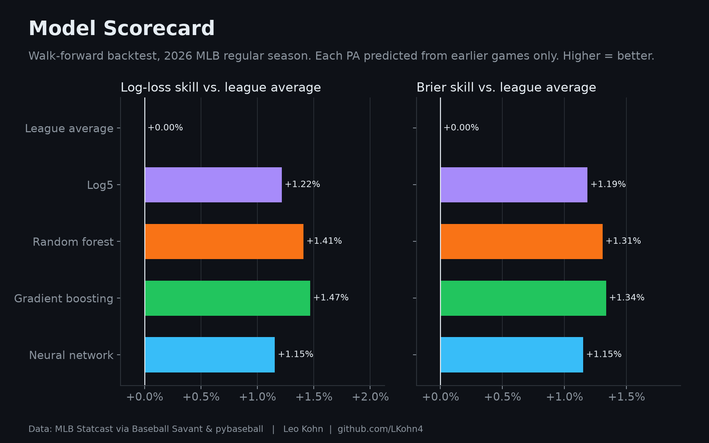 |
| **The season at a glance** | **Five models, scored on games they never saw** |
| 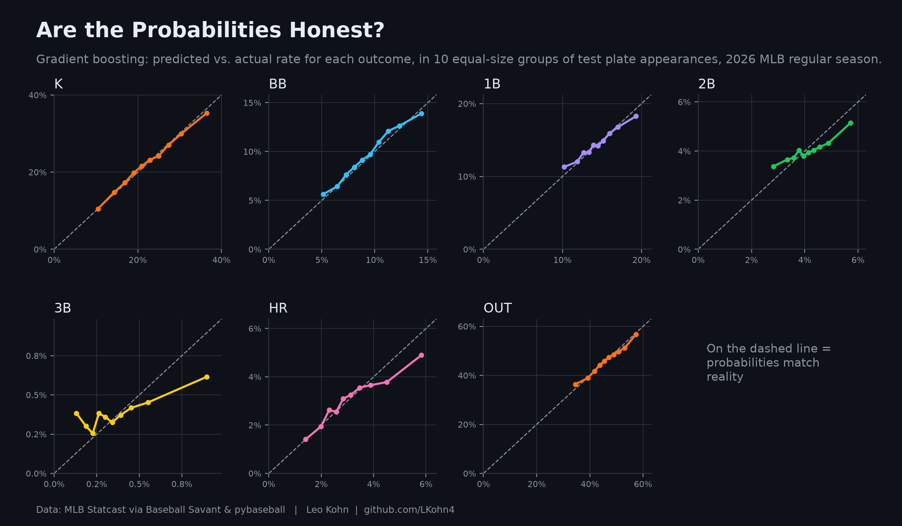 | 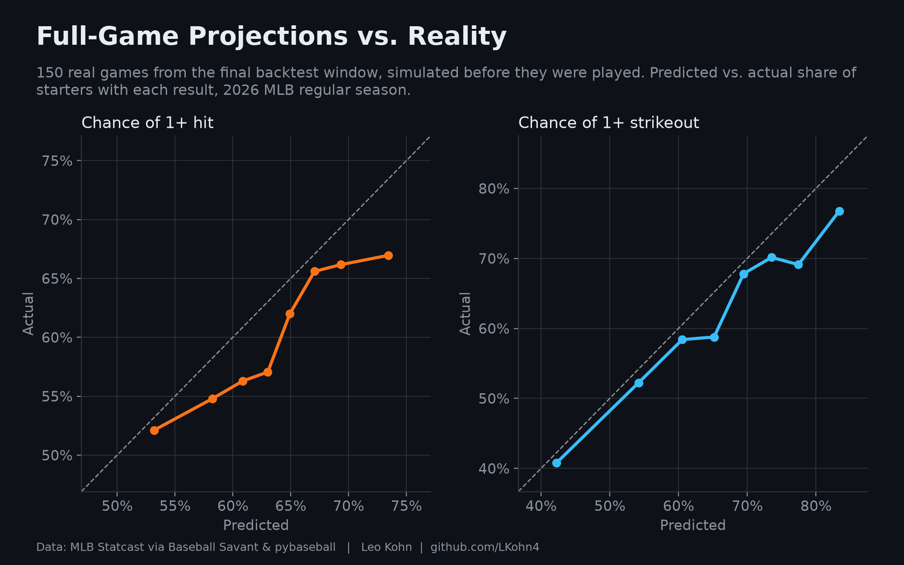 |
| **Are the probabilities honest?** | **Full-game projections vs. what actually happened** |

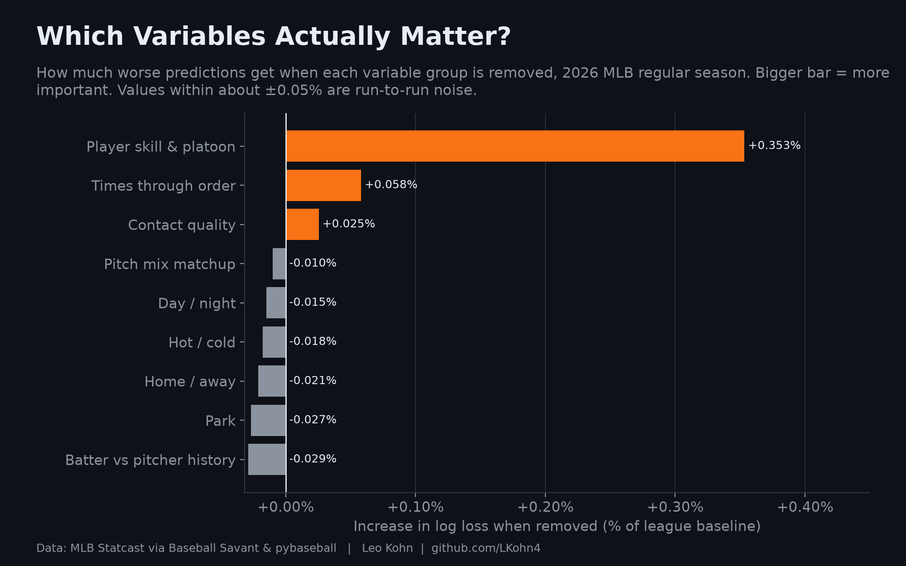
**Which variables actually matter?** The model is retrained without each group, and the chart shows how much worse it gets.

### What the 2026 data says

| | |
| :---: | :---: |
| 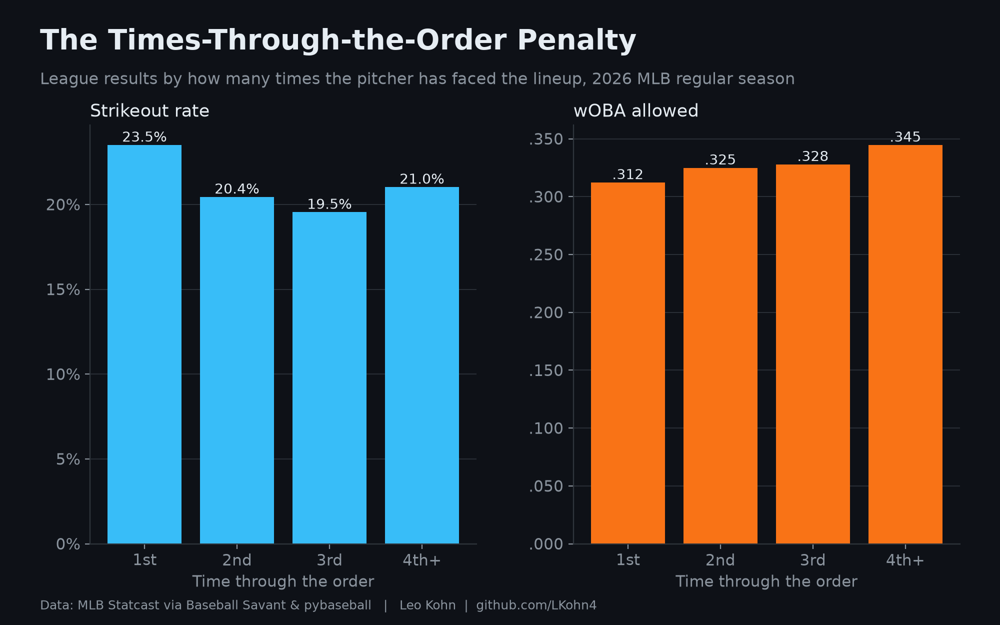 | 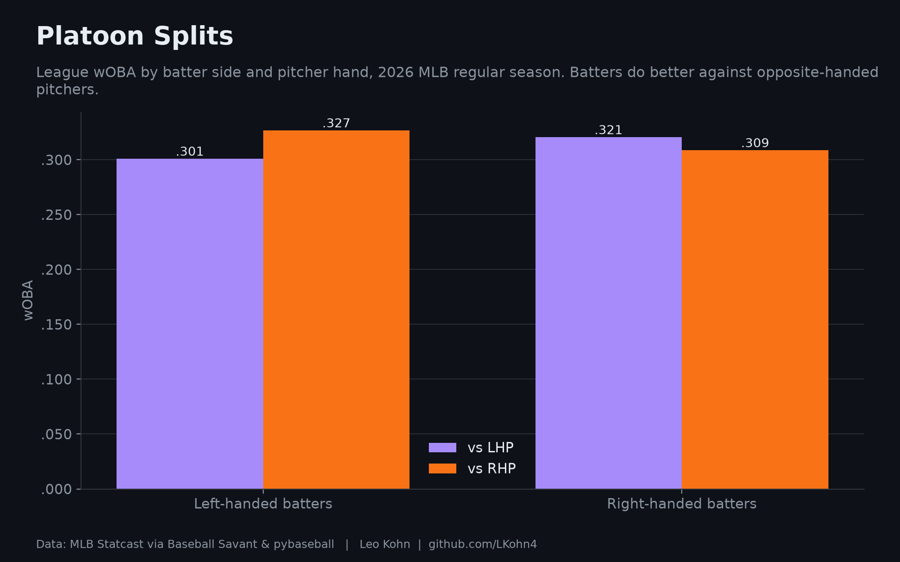 |
| 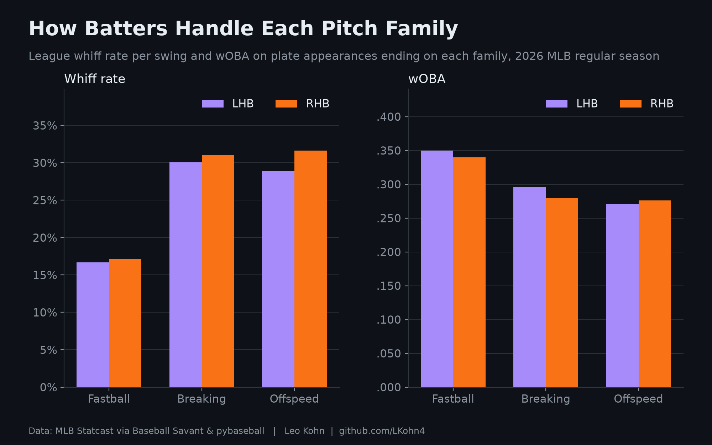 | 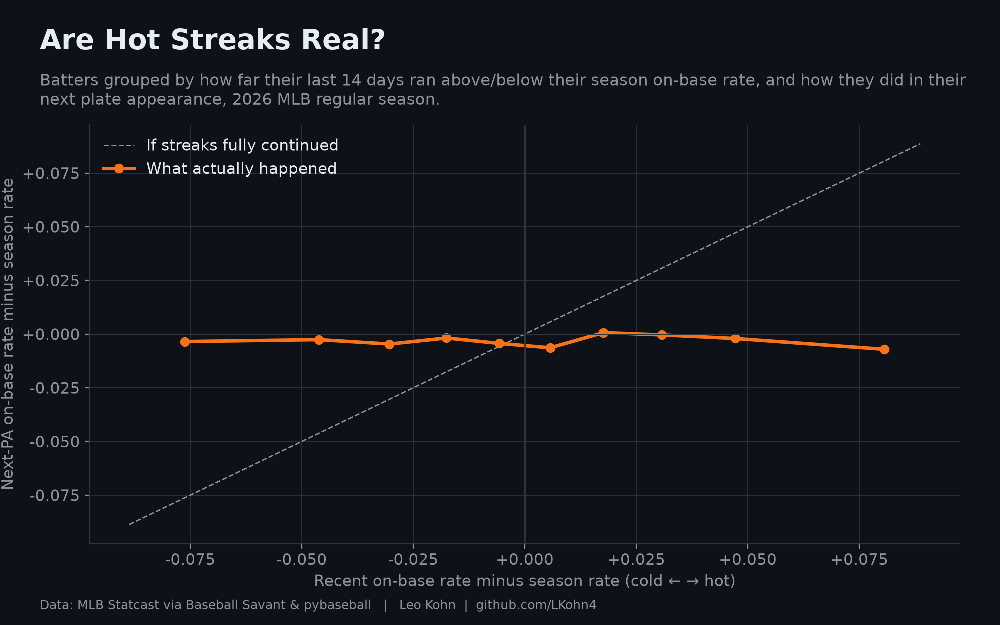 |
| 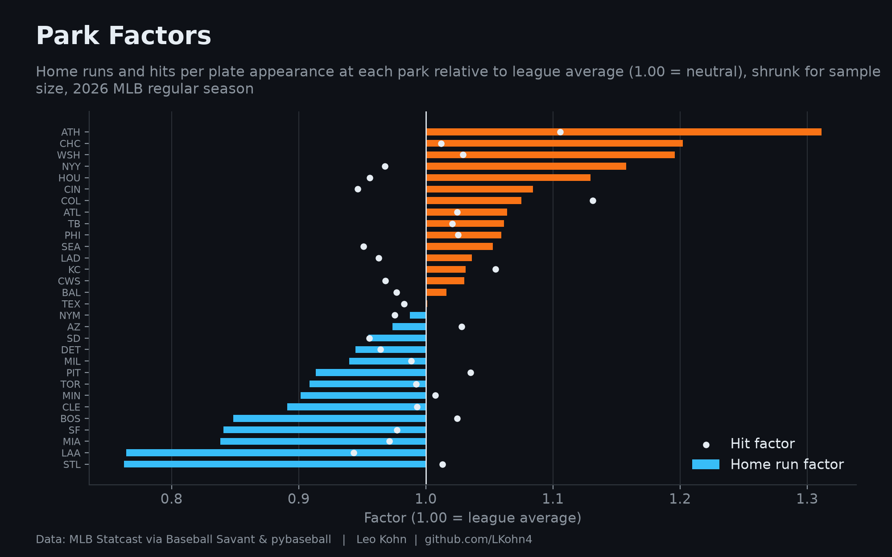 | 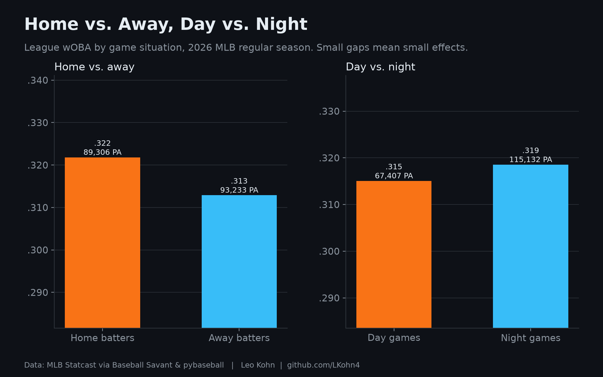 |

---

## Results

<!--
  After `mlb-matchup train`, copy the numbers from results/model_scorecard.md into this table.
  Log-loss skill = % better than always predicting the league average (higher is better).
-->

Walk-forward backtest on the 2026 regular season (three monthly folds, July–September). Every test plate appearance was predicted using only games played before it.

| Model | Log loss | Brier | Skill vs league % | Skill vs log5 % |
| --- | --- | --- | --- | --- |
| League average | 1.4549 | 0.7051 | 0.0000 | -1.2153 |
| Log5 | 1.4373 | 0.6967 | 1.2153 | 0.0000 |
| Random forest | 1.4344 | 0.6958 | 1.4085 | 0.1932 |
| Gradient boosting | 1.4336 | 0.6956 | 1.4677 | 0.2524 |
| Neural network | 1.4381 | 0.6969 | 1.1549 | -0.0604 |

**How to read these numbers.** A single plate appearance is mostly luck, so even an excellent model is only a few percent better than the league average on log loss. That's normal in baseball projection. The value shows up when thousands of plate appearances add up, as they do in the full-game backtest.

### Key findings
- **Gradient boosting was the best model**, beating the league-average baseline by about 1.5% in log loss and beating log5 in every monthly fold. The extra variables add real information beyond the classic batter-vs-pitcher formula.
- **Player skill and platoon splits carry most of the signal.** Removing them hurts the model far more than any other group.
- **The times-through-the-order penalty is real and useful**: it was the second most valuable variable group.
- **Within one season, the situational factors barely matter once skill is known.** Pitch-mix matchups, batter-vs-pitcher history, home/away, day/night, park and hot/cold streaks all changed accuracy by less than the run-to-run noise. This matches long-standing sabermetric findings that head-to-head samples and short streaks are mostly noise. Next up: adding 2024–25 history as a prior, which gives these variables far bigger samples.

---

## Quick start

```bash
git clone https://github.com/LKohn4/mlb-matchup-projections.git
cd mlb-matchup-projections
python -m venv .venv && source .venv/bin/activate
pip install -e ".[dev]"

mlb-matchup train                                        # backtest, train, build the dashboard
mlb-matchup card LAD NYY --date 2026-10-02 --time night  # auto-fill a game card
mlb-matchup project game_cards/2026-10-02_LAD_at_NYY.yaml
```

The first `train` downloads the 2026 season from Baseball Savant (10–30 minutes) and caches it in `data/`. PyCharm users: see **[docs/PYCHARM_SETUP.md](docs/PYCHARM_SETUP.md)**, which comes with one-click run configurations.

| Command | What it does |
| --- | --- |
| `mlb-matchup train` | Walk-forward backtest, variable study, full-game backtest, final model, dashboard, example game |
| `mlb-matchup train --quick` | Fast settings for a first test run |
| `mlb-matchup card AWAY HOME` | Writes a game card from each team's latest lineup, rotation and bullpen |
| `mlb-matchup project CARD.yaml` | Projects the game: report, figures and CSVs in `results/games/<game>/` |
| `mlb-matchup players QUERY` | Searches 2026 players by name (shows IDs, teams and handedness) |

## Writing a game card

A game card is a small, readable YAML file (see [`game_cards/TEMPLATE.yaml`](game_cards/TEMPLATE.yaml)):

```yaml
game:
  date: 2026-10-02      # projections use 2026 games played before this date
  park: NYY             # home team's park
  time: night           # day, night or unknown

away:
  team: LAD
  lineup: ["Hitter One", "Hitter Two", ...]    # exactly 9, in batting order
  bench: ["Bench Bat"]                          # optional
  pitchers:
    starter: "Starting Pitcher"
    starter_innings: 5.5                        # optional; default = his 2026 average
    opener: null                                # optional
    relievers: ["Reliever A", "Reliever B", "Reliever C"]   # up to 3
    reliever_weights: [0.4, 0.35, 0.25]         # optional: how likely each is used
    closer: "Closer"
home:
  ...
```

Names are matched to 2026 players. Shared names can be written `"Name (TEAM)"` or `"ID 123456"`, and typos get a *did you mean…?* suggestion.

**What you get for each game:**

- **Each batter:** projected PA, H, HR, K, BB, total bases, xwOBA, and the chance of 1+ hit, 2+ hits, 1+ HR and 1+ strikeout.
- **Expected plate appearances against each pitcher** (starter, opener, each reliever, closer).
- **Per-PA projections** for every batter against every pitcher, including a *reliever scenario* grid for each of the 3 bullpen options.
- **Each pitcher:** chance of appearing, innings, K, H, BB, HR and runs.
- **Bench players** projected against every opposing pitcher.
- **Team level:** win probability, projected runs and the run distribution.

## Methodology

### The variables

| What you asked the model to consider | How it's measured (52 features in 9 groups) |
| --- | --- |
| Pitcher handedness / platoon | Batter's rates vs. that hand, and the pitcher's vs. that batting side; switch hitters take the advantage |
| Pitch mix and how batters hit each pitch | Pitcher's fastball/breaking/offspeed usage **against this batter's side** × batter's whiff rate and hit rate on each family |
| Previous batter-vs-pitcher matchups | Head-to-head plate appearances, on-base and strikeout history, heavily shrunk because samples are tiny |
| Innings / how deep the starter goes | Starter's 2026 average outs per start (or your override), simulated with variation |
| At-bats vs. each pitcher | Emerges from the simulation: lineup turnover, pitching changes, extra innings |
| 1st vs. 2nd vs. 3rd time up | Times through the order, the batter's PA number in the game, and the pitcher's pitch count |
| Home / away | Batter's team at home or on the road |
| Day / night | From MLB's schedule |
| Park | Home-run and hit park factors from 2026, shrunk for sample size |
| Hot / cold | Last 14 days vs. season-to-date (on-base, hard-hit rate, pitcher strikeouts) |
| Contact quality | Batter's hard-hit rate (95+ mph) and the pitcher's hard-hit rate allowed |

### Principles carried over from mlb-hit-probability

1. **No peeking at the future.** Every feature for a plate appearance on date *D* is built only from games before *D*. A unit test checks that all 52 features stay identical when later games are deleted.
2. **Honest baselines.** Every model must beat both the league average and **log5**, the classic odds-ratio formula that combines batter, pitcher and league rates.
3. **Probabilities, not accuracy.** Outs happen in most plate appearances, so "accuracy" is misleading. Models are scored on log loss and Brier score, and calibration is checked outcome by outcome.
4. **Small samples are shrunk.** Each rate blends the player's record with the league average, weighted by how much evidence exists. Platoon splits shrink toward the player's overall rates, since splits need big samples.

### Models

All models predict seven outcomes (K, BB/HBP, 1B, 2B, 3B, HR, out in play):

- a **random forest**
- **gradient boosting**
- a **neural network** (64-32 units, softmax, early stopping)

The trees use large leaves and shallow depth, because plate-appearance outcomes are noisy and flexible models otherwise memorize luck. The model with the best walk-forward log loss is retrained on the full season and saved.

### Validation

- **Walk-forward backtest:** train through June, test July; train through July, test August; train through August, test September.
- **Variable study:** gradient boosting is retrained without each variable group to measure what each one adds.
- **Full-game backtest:** real September games are rebuilt from their actual lineups and starters, using bullpens as they were known beforehand. Each is simulated before it's scored, and the predicted chance of each starter getting 1+ hit or 1+ strikeout is compared with what happened.

### Simulator

The simulator runs 10,000 games in well under a second, vectorized with NumPy. It models:

- openers, and starters pulled at a sampled out count
- relievers picked each inning by your weights
- the closer in save situations
- walk-offs, and the home team skipping the bottom of the 9th when ahead
- the extra-inning runner on second

Baserunning uses MLB-typical rates:

- extra bases on hits
- sacrifice flies and double plays
- errors, steals and wild pitches

With league-average players it scores about 4.4 runs per team per game, matching MLB.

### Limitations

- **One season only.** By design, the model uses 2026 data alone, so early-season and rookie profiles rest on the league average until evidence builds up.
- **Fixed baserunning.** Baserunning and defense are fixed league-typical rates, not player-specific (no sprint speed or fielding).
- **Bench not simulated.** Bench players are projected per plate appearance but aren't substituted in the simulation.
- **Simplified bullpen.** Relievers are chosen by inning and don't track fatigue, and any runs scored count against the pitcher on the mound.
- **Projections, not predictions.** Single-game baseball outcomes are highly random; the numbers are best read as probabilities.

## Project structure

```
src/matchup/
  config.py      constants, shrinkage settings, run configuration
  data.py        Statcast download and cache, plate-appearance table, in-game context
  external.py    day/night schedule and player names (MLB Stats API, fails soft)
  players.py     player directory: names, teams, handedness, name -> ID matching
  features.py    point-in-time features (the no-leak engine)
  models.py      baselines, random forest, gradient boosting, neural network
  evaluate.py    log loss, Brier, calibration
  backtest.py    walk-forward folds, variable study, full-game backtest
  simulate.py    vectorized Monte Carlo game simulator
  gamecard.py    game card format, validation, auto-fill from 2026 usage
  project.py     card -> matchup probabilities -> simulated projection
  plots.py       dark-theme dashboard figures
  dashboard.py   season and model dashboard
  report.py      single-game report (figures, CSVs, Markdown)
  pipeline.py    train / card / project workflows
  cli.py         the mlb-matchup command
tests/           offline tests on synthetic, realistically structured games
game_cards/      TEMPLATE.yaml and generated example cards
docs/            PyCharm setup guide
```

## Development

```bash
pytest -q          # offline tests: synthetic data, no downloads
ruff check src tests
```

CI runs linting and tests on Python 3.11 and 3.12 for every push.

## Data and credits

- **Pitch-by-pitch data:** [MLB Statcast](https://baseballsavant.mlb.com/) via [pybaseball](https://github.com/jldbc/pybaseball), 2026 regular season (March 25 – September 27).
- **Day/night and player names:** MLB's public Stats API (the source behind Baseball Savant), because Statcast pitch data doesn't include them. Chadwick Bureau's register is the name fallback.
- **Methods:** log5 (Bill James), stabilization-style shrinkage, and the times-through-the-order penalty, all from the sabermetric research community.

Created by **Leo Kohn**. GitHub: [@LKohn4](https://github.com/LKohn4). Email: [leo@kohn.be](mailto:leo@kohn.be).

If you use this project, please cite it via [`CITATION.cff`](CITATION.cff).

## License

[MIT](LICENSE) © 2026 Leo Kohn. This project isn't affiliated with or endorsed by MLB. Statcast data is subject to MLB Advanced Media's terms of use.
