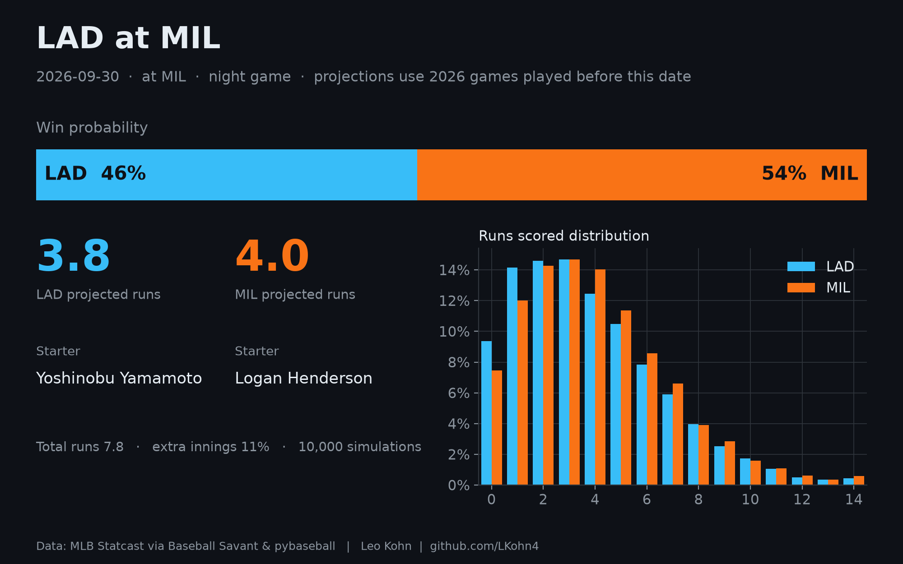
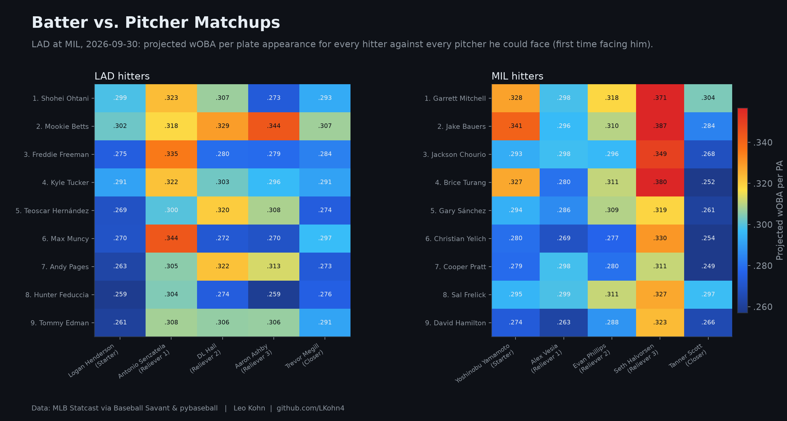
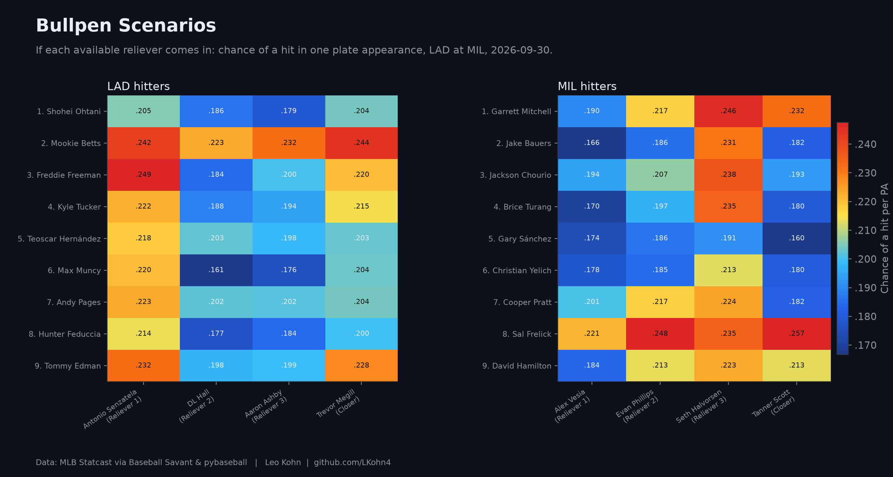
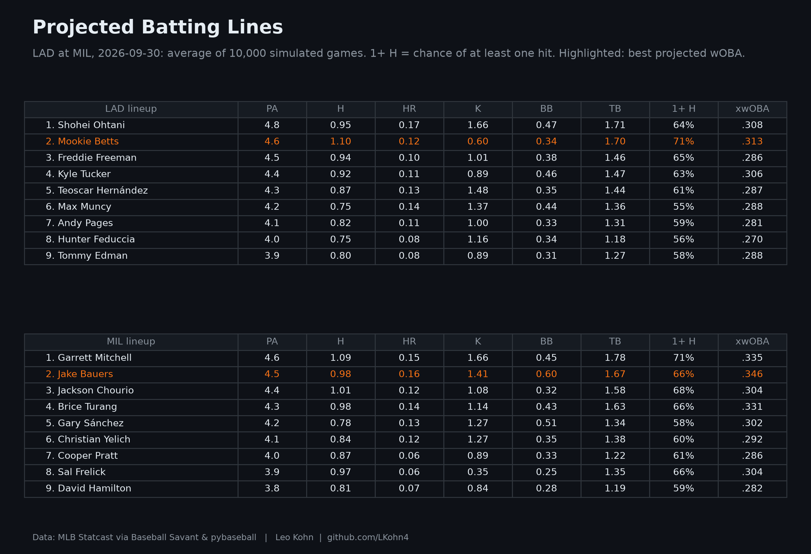

# LAD at MIL — 2026-09-30

Park: MIL · night game · 10,000 simulations

**Win probability:** LAD 46% · MIL 54%  
**Projected runs:** LAD 3.8 · MIL 4.0

## LAD batters

| # | Batter | PA | H | HR | K | BB | P(1+ H) | xwOBA |
| --- | --- | --- | --- | --- | --- | --- | --- | --- |
| 1 | Shohei Ohtani | 4.759 | 0.946 | 0.173 | 1.663 | 0.469 | 0.640 | 0.308 |
| 2 | Mookie Betts | 4.647 | 1.104 | 0.119 | 0.603 | 0.344 | 0.706 | 0.313 |
| 3 | Freddie Freeman | 4.540 | 0.940 | 0.095 | 1.014 | 0.375 | 0.646 | 0.286 |
| 4 | Kyle Tucker | 4.425 | 0.915 | 0.107 | 0.888 | 0.461 | 0.632 | 0.306 |
| 5 | Teoscar Hernández | 4.325 | 0.873 | 0.128 | 1.476 | 0.347 | 0.612 | 0.287 |
| 6 | Max Muncy | 4.220 | 0.754 | 0.135 | 1.372 | 0.442 | 0.552 | 0.288 |
| 7 | Andy Pages | 4.107 | 0.823 | 0.106 | 1.002 | 0.331 | 0.588 | 0.281 |
| 8 | Hunter Feduccia | 3.987 | 0.754 | 0.078 | 1.160 | 0.344 | 0.555 | 0.270 |
| 9 | Tommy Edman | 3.868 | 0.803 | 0.085 | 0.888 | 0.315 | 0.581 | 0.288 |

## MIL batters

| # | Batter | PA | H | HR | K | BB | P(1+ H) | xwOBA |
| --- | --- | --- | --- | --- | --- | --- | --- | --- |
| 1 | Garrett Mitchell | 4.630 | 1.090 | 0.153 | 1.656 | 0.448 | 0.707 | 0.335 |
| 2 | Jake Bauers | 4.516 | 0.979 | 0.163 | 1.411 | 0.601 | 0.660 | 0.346 |
| 3 | Jackson Chourio | 4.410 | 1.009 | 0.123 | 1.084 | 0.321 | 0.676 | 0.304 |
| 4 | Brice Turang | 4.304 | 0.982 | 0.142 | 1.141 | 0.431 | 0.660 | 0.331 |
| 5 | Gary Sánchez | 4.205 | 0.784 | 0.130 | 1.275 | 0.510 | 0.576 | 0.302 |
| 6 | Christian Yelich | 4.101 | 0.842 | 0.119 | 1.268 | 0.346 | 0.603 | 0.292 |
| 7 | Cooper Pratt | 3.992 | 0.867 | 0.059 | 0.888 | 0.332 | 0.610 | 0.286 |
| 8 | Sal Frelick | 3.872 | 0.967 | 0.060 | 0.351 | 0.245 | 0.658 | 0.304 |
| 9 | David Hamilton | 3.753 | 0.805 | 0.072 | 0.836 | 0.277 | 0.586 | 0.282 |

## Pitchers

| Team | Role | Pitcher | P(appears) | IP | K | H | BB | R |
| --- | --- | --- | --- | --- | --- | --- | --- | --- |
| LAD | Starter | Yoshinobu Yamamoto | 1.00 | 6.48 | 7.25 | 6.35 | 2.52 | 2.96 |
| LAD | Reliever 1 | Alex Vesia | 0.51 | 0.56 | 0.76 | 0.46 | 0.27 | 0.23 |
| LAD | Reliever 2 | Evan Phillips | 0.52 | 0.57 | 0.72 | 0.53 | 0.24 | 0.27 |
| LAD | Reliever 3 | Seth Halvorsen | 0.52 | 0.57 | 0.56 | 0.60 | 0.35 | 0.35 |
| LAD | Closer | Tanner Scott | 0.37 | 0.46 | 0.62 | 0.38 | 0.14 | 0.21 |
| MIL | Starter | Logan Henderson | 1.00 | 5.42 | 5.91 | 4.57 | 1.69 | 2.06 |
| MIL | Reliever 1 | Antonio Senzatela | 0.73 | 1.06 | 0.97 | 1.03 | 0.44 | 0.51 |
| MIL | Reliever 2 | DL Hall | 0.73 | 1.05 | 1.19 | 0.89 | 0.58 | 0.47 |
| MIL | Reliever 3 | Aaron Ashby | 0.73 | 1.05 | 1.30 | 0.90 | 0.53 | 0.43 |
| MIL | Closer | Trevor Megill | 0.43 | 0.58 | 0.69 | 0.52 | 0.19 | 0.31 |

