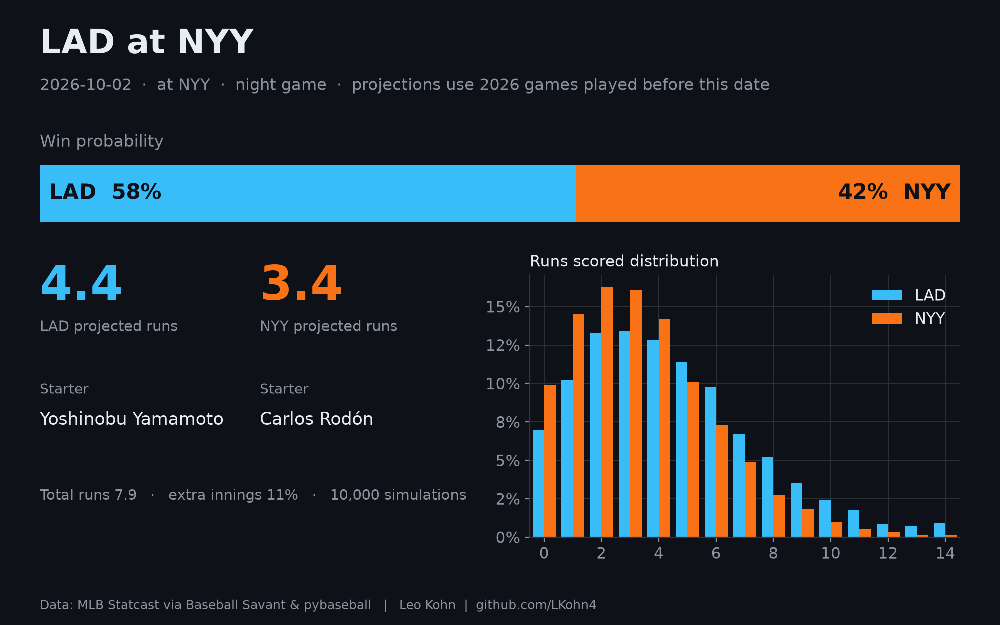
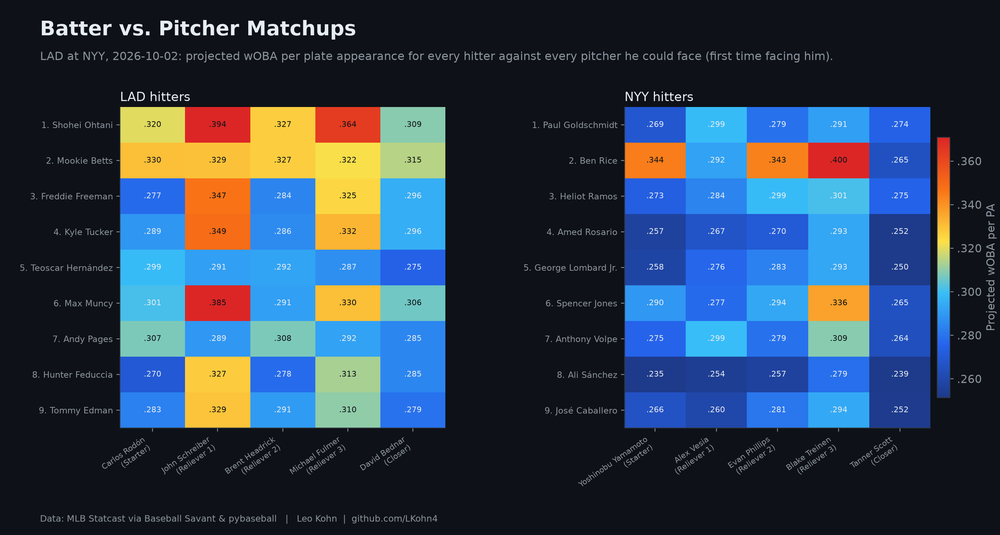
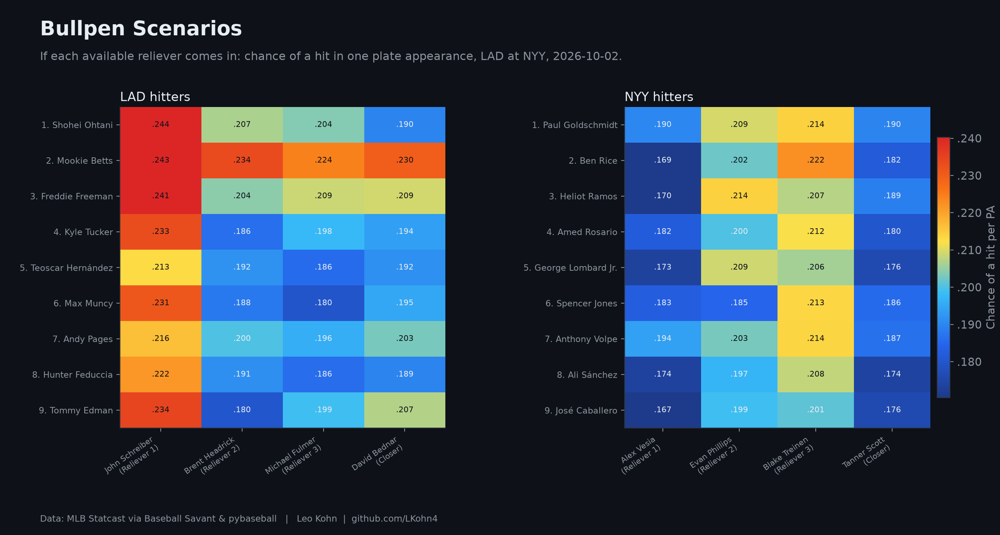
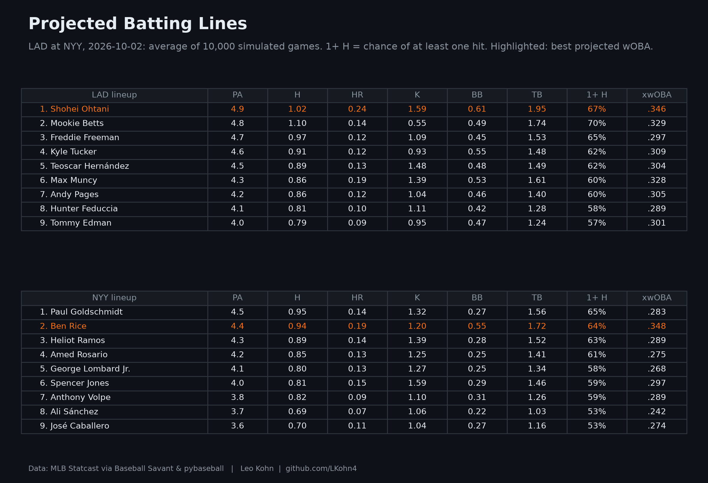

# LAD at NYY — 2026-10-02

Park: NYY · night game · 10,000 simulations

**Win probability:** LAD 58% · NYY 42%  
**Projected runs:** LAD 4.4 · NYY 3.4

## LAD batters

| # | Batter | PA | H | HR | K | BB | P(1+ H) | xwOBA |
| --- | --- | --- | --- | --- | --- | --- | --- | --- |
| 1 | Shohei Ohtani | 4.904 | 1.024 | 0.236 | 1.591 | 0.607 | 0.670 | 0.346 |
| 2 | Mookie Betts | 4.797 | 1.103 | 0.142 | 0.552 | 0.494 | 0.701 | 0.329 |
| 3 | Freddie Freeman | 4.685 | 0.971 | 0.116 | 1.087 | 0.445 | 0.651 | 0.297 |
| 4 | Kyle Tucker | 4.566 | 0.912 | 0.119 | 0.932 | 0.546 | 0.624 | 0.309 |
| 5 | Teoscar Hernández | 4.460 | 0.888 | 0.134 | 1.476 | 0.477 | 0.615 | 0.304 |
| 6 | Max Muncy | 4.347 | 0.861 | 0.190 | 1.388 | 0.526 | 0.603 | 0.328 |
| 7 | Andy Pages | 4.244 | 0.858 | 0.118 | 1.042 | 0.462 | 0.601 | 0.305 |
| 8 | Hunter Feduccia | 4.130 | 0.806 | 0.104 | 1.114 | 0.416 | 0.577 | 0.289 |
| 9 | Tommy Edman | 4.014 | 0.788 | 0.091 | 0.953 | 0.473 | 0.573 | 0.301 |

## NYY batters

| # | Batter | PA | H | HR | K | BB | P(1+ H) | xwOBA |
| --- | --- | --- | --- | --- | --- | --- | --- | --- |
| 1 | Paul Goldschmidt | 4.481 | 0.947 | 0.143 | 1.325 | 0.268 | 0.647 | 0.283 |
| 2 | Ben Rice | 4.367 | 0.936 | 0.190 | 1.202 | 0.548 | 0.639 | 0.348 |
| 3 | Heliot Ramos | 4.275 | 0.891 | 0.144 | 1.387 | 0.281 | 0.627 | 0.289 |
| 4 | Amed Rosario | 4.172 | 0.850 | 0.127 | 1.250 | 0.249 | 0.606 | 0.275 |
| 5 | George Lombard Jr. | 4.063 | 0.796 | 0.127 | 1.271 | 0.246 | 0.579 | 0.268 |
| 6 | Spencer Jones | 3.959 | 0.808 | 0.152 | 1.594 | 0.291 | 0.588 | 0.297 |
| 7 | Anthony Volpe | 3.849 | 0.818 | 0.092 | 1.097 | 0.305 | 0.591 | 0.289 |
| 8 | Ali Sánchez | 3.726 | 0.689 | 0.066 | 1.064 | 0.225 | 0.527 | 0.242 |
| 9 | José Caballero | 3.603 | 0.698 | 0.110 | 1.038 | 0.266 | 0.532 | 0.274 |

## Pitchers

| Team | Role | Pitcher | P(appears) | IP | K | H | BB | R |
| --- | --- | --- | --- | --- | --- | --- | --- | --- |
| LAD | Starter | Yoshinobu Yamamoto | 1.00 | 6.48 | 8.04 | 5.59 | 1.85 | 2.48 |
| LAD | Reliever 1 | Alex Vesia | 0.54 | 0.60 | 0.90 | 0.44 | 0.27 | 0.22 |
| LAD | Reliever 2 | Evan Phillips | 0.54 | 0.61 | 0.81 | 0.50 | 0.17 | 0.25 |
| LAD | Reliever 3 | Blake Treinen | 0.52 | 0.58 | 0.68 | 0.53 | 0.23 | 0.28 |
| LAD | Closer | Tanner Scott | 0.41 | 0.51 | 0.79 | 0.36 | 0.15 | 0.21 |
| NYY | Starter | Carlos Rodón | 1.00 | 5.23 | 6.02 | 4.58 | 2.55 | 2.37 |
| NYY | Reliever 1 | John Schreiber | 0.75 | 1.12 | 0.92 | 1.19 | 0.51 | 0.66 |
| NYY | Reliever 2 | Brent Headrick | 0.76 | 1.16 | 1.35 | 0.99 | 0.51 | 0.50 |
| NYY | Reliever 3 | Michael Fulmer | 0.76 | 1.13 | 1.29 | 1.00 | 0.66 | 0.58 |
| NYY | Closer | David Bednar | 0.38 | 0.54 | 0.56 | 0.46 | 0.22 | 0.31 |

